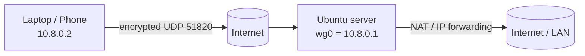

# WireGuard VPN Setup Guide

A practical, step-by-step guide to set up a **WireGuard VPN server on Ubuntu** and connect Linux and Windows clients to it.

**Read it online:** https://ottonielmorais2008-rgb.github.io/wireguard-setup-guide/

## What you will build



- A server listening on UDP port `51820` with the tunnel network `10.8.0.0/24`
- One or more clients (peers), each with its own key pair and tunnel IP
- Optional full-tunnel mode, where all client traffic goes through the server

## Contents

1. [Requirements](docs/01-requirements.md)
2. [Server setup](docs/02-server-setup.md)
3. [Client setup (Linux and Windows)](docs/03-client-setup.md)
4. [Adding more peers](docs/04-adding-peers.md)
5. [Troubleshooting](docs/05-troubleshooting.md)
6. [Security checklist](docs/06-security.md)

## Quick start (server)

```bash
sudo apt update && sudo apt install -y wireguard
umask 077
wg genkey | sudo tee /etc/wireguard/server.key | wg pubkey | sudo tee /etc/wireguard/server.pub
```

Then follow [Server setup](docs/02-server-setup.md) to write `/etc/wireguard/wg0.conf` and start the service.

## Tested on

- Ubuntu Server 22.04 LTS and 24.04 LTS
- WireGuard clients for Linux (`wireguard-tools`) and Windows (official app)

## Contributing

Found a mistake or a missing step? Open an issue or a pull request.

## License

[MIT](LICENSE)
