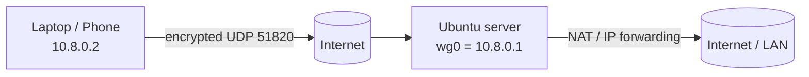

# WireGuard VPN Setup Guide

A practical, step-by-step guide to set up a **WireGuard VPN server on Ubuntu** and connect Linux and Windows clients to it.

**Read it online:** https://ottonielmorais2008-rgb.github.io/wireguard-setup-guide/

## What you will build



- A server listening on UDP port `51820` with the tunnel network `10.8.0.0/24`
- One or more clients (peers), each with its own key pair and tunnel IP
- Optional full-tunnel mode, where all client traffic goes through the server

## Contents

1. [Requirements](docs/01-requirements.md)
2. [Server setup](docs/02-server-setup.md)
3. [Client setup (Linux and Windows)](docs/03-client-setup.md)
4. [Adding more peers](docs/04-adding-peers.md)
5. [Troubleshooting](docs/05-troubleshooting.md)
6. [Security checklist](docs/06-security.md)

## Quick start (server)

```bash
sudo apt update && sudo apt install -y wireguard iptables
umask 077
wg genkey | sudo tee /etc/wireguard/server.key | wg pubkey | sudo tee /etc/wireguard/server.pub
sudo chmod 600 /etc/wireguard/server.key
```

Then follow [Server setup](docs/02-server-setup.md) to write `/etc/wireguard/wg0.conf` and start the service.

## Tested on

Tested on 2026-11-03 with **Ubuntu 24.04.5 LTS userspace** (the official `ubuntu-base` image) in two chroots, each in its own Linux network namespace (one server, one client), on a Linux 6.12 host with the in-kernel WireGuard module. This was **not a full VM or a real cloud server**.

- Worked: install, key generation, `wg0.conf`, `wg-quick up/down`, IP forwarding, NAT (`MASQUERADE`), ping across the tunnel, full-tunnel traffic through the server, `wg set` to add and remove peers.
- Not tested: `systemctl` / `journalctl` (no systemd in a chroot; `wg-quick@wg0` runs the same `wg-quick up wg0`), UFW (the test host kernel lacks the `LOG`/`limit` modules UFW needs), the `DNS` line (no `systemd-resolved`), `curl ifconfig.me`, Ubuntu 22.04, and the Windows client.

## Contributing

Found a mistake or a missing step? Open an issue or a pull request.

## License

[MIT](LICENSE)
